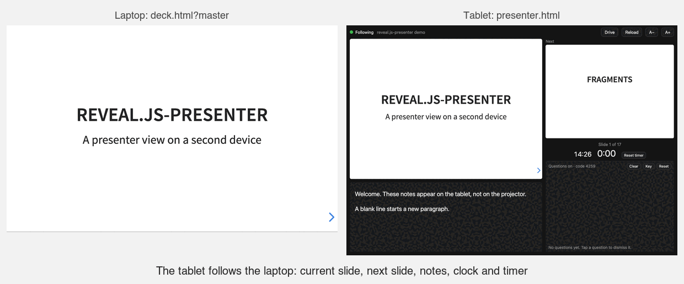

# reveal.js-presenter

A presenter view for [reveal.js](https://revealjs.com) on a second device. Prop
an iPad on the lectern (or hold a phone), and it shows:

- the current slide, exactly as the audience sees it, fragments included;
- the next slide, or the next fragment, so you know what your click will reveal;
- your speaker notes (`<aside class="notes">` or `data-notes`), resizable;
- a clock and a timer; and badges for a blanked screen or open overview.

reveal.js's own speaker view (the `S` key) opens a popup tied to the laptop's
browser, so it can't move to another device. This can, and it works when you
are nowhere near the laptop. Optionally, the audience can send questions to it
from their phones, by scanning a QR code on a slide.



## Try it on one computer

Five minutes, with Node 18 or later. From this directory:

```
npm --prefix server install
node server/relay.js &
node tools/make-channel.js http://127.0.0.1:1948 --write client/presenter-config.js \
     --ask http://127.0.0.1:8000/client/ask.html
python3 -m http.server 8000 --bind 127.0.0.1
```

`make-channel.js` prints a **secret** and a **questions key**. Then, in two
browser windows:

1. **"Laptop":** `http://127.0.0.1:8000/example/index.html?master=<secret>`
2. **"Tablet":** `http://127.0.0.1:8000/client/presenter.html`. Make the window
   tablet-sized, tap **Start**, and enter the questions key when asked.

Step through the deck in the first window; the second follows. On the
*Questions?* slide, open the QR code's link (or `client/ask.html`) in a third
window and send a question. When you're done, stop the two servers. The
generated `client/presenter-config.js` is ignored by git.

Everything here runs on `127.0.0.1`. To use a real tablet, the relay and the
decks must be reachable from it: see [Doing it by hand](#doing-it-by-hand).

## How it works

```
 laptop                              relay                         tablet
 deck.html?master=<secret>  ──►  Socket.IO server  ──►  presenter.html
 broadcasts {position, deck}     forwards it only if    loads the same deck twice
 on every change + every 3 s     sha256(secret) =       (current + next), drives
                                 channel id             them, shows notes & time
```

- The **laptop** runs your deck with `?master=<secret>` on the URL. A small
  script broadcasts the deck's position on every slide or fragment change, and
  again every 3 s.
- The **relay** forwards each message to everyone listening on that channel. It
  only does so if the message's secret hashes (SHA-256) to the channel id. Any
  [reveal/multiplex](https://github.com/reveal/multiplex) server works; so does
  the stricter one in `server/`.
- The **tablet** opens `presenter.html`, which loads your deck twice in
  iframes: one for the current slide and one for the next. It moves both to
  follow the laptop, through each copy's `Reveal` object.

The two devices never connect to each other, only to the relay. So they need
internet access, but not the same network. That matters because conference
and university WiFi (eduroam, for instance) usually blocks devices on it from
reaching each other directly.

A deck opened *without* `?master` is untouched. The script returns
immediately, and the deck never contacts the relay. So your published decks
behave exactly as before, for you and for everyone else.

## Using it with Claude Code

Open Claude Code in the project that holds your presentations and say
something like:

> Add the presenter view from ~/Source/reveal.js/presenter to my decks.

The agent should read [`CLAUDE.md`](CLAUDE.md) in this directory. It describes
how to fit the package to different deck setups (plain HTML, templated, ES
modules), what to ask you, and the design decisions that must not be
"simplified" away.

## Doing it by hand

1. **Pick a relay.** Use an existing reveal/multiplex server, or deploy
   `server/` (see [Running the relay](#running-the-relay)). It must be on
   HTTPS if your decks are.
2. **Make a channel:**
   `node tools/make-channel.js https://relay.example.org --write client/presenter-config.js`.
   It prints the **secret**. Keep the secret private and out of every file you
   publish.
3. **Install the client.** Put `presenter.html`, `presenter-master.js` and
   `presenter-config.js` together in one directory on the **same site** as
   your decks, e.g. `/presenter/`. The presenter page drives the decks through
   their JavaScript, which browsers allow only within one origin.
4. **Add two lines to every deck**, or once to a shared template, anywhere
   after reveal.js is loaded:
   ```html
   <script src="/presenter/presenter-config.js"></script>
   <script src="/presenter/presenter-master.js"></script>
   ```
   The deck must expose `window.Reveal`. The standard `dist/reveal.js` script
   does this. With ES modules, add `window.Reveal = deck` after creating it.
5. **Publish** the decks and the `/presenter/` directory.

## In the room

1. Laptop: open the deck as `…/deck.html?master=<secret>`. Bookmark it.
2. Tablet: open `https://your.site/presenter/presenter.html` and tap
   **Start**. That starts the timer and asks the device not to sleep. On an
   iPad, Safari's *Share → Add to Home Screen* gives it a full-screen icon.
3. The status light shows the connection:
   - green: following the laptop;
   - amber: connected, but the laptop has gone quiet (its lid is closed, or the
     deck isn't open with `?master`);
   - red: the relay can't be reached.

The tablet follows whichever deck the laptop broadcasts, so one bookmark works
for a whole course or conference. `?deck=/path/to/deck.html` preloads a deck
before the laptop speaks.

The tablet loads the deck *from the site*, so the published copy must match
the one on the laptop. If you present from a local copy, publish your changes
first, or the slides won't line up. If the laptop serves decks under different
paths from the site, set `deckUrl` in `presenter-config.js` to map one onto the
other.

## Audience questions

Students can send questions straight to the tablet, from their phones:

1. The **laptop** deck shows a 4-digit code on a slide: put
   `<span class="question-code">····</span>` wherever you want it. Only the
   laptop's copy knows the code, because it is derived from the secret, and it
   changes daily. Everyone else, including the published deck, sees the dots.
2. **Students** open `ask.html`, most easily by scanning a QR code on the
   same slide (below), which fills the code in for them. They type a question
   of up to 280 characters, and press Send. They are told whether it was
   delivered.
3. The **tablet** shows each question in its lower-right corner, newest
   first. The clock and timer shrink to make room; tap a question to dismiss
   it. The tablet also shows the day's code.

Two keys keep it private:
- **Posting needs the code on the slide.** That stops anyone who isn't in the
  room or following the lecture live.
- **Reading needs the tablet key.** You type it on the tablet once, and the
  tablet remembers it. Without it, knowing the (public) channel gets you
  nothing.

**Questions are transient.** The relay hands each one to the tablet's open
connection and forgets it. Questions are never stored or logged anywhere. If
the tablet isn't connected, the question is refused, and the student is told
so. On the tablet, questions live only in the open page.

**Limits:** one question per page every 10 s, and 20 a minute per channel.
There is also a generous per-address cap; it can't be strict, because a whole
lecture hall on university WiFi may share a few public addresses.

To turn questions on, `tools/make-channel.js` prints a tablet key and puts its
hash in `presenter-config.js` as `questionsKey`. Without `questionsKey`,
everything behaves as before.

**The QR code.** Put `<div class="question-qr"></div>` on the slide, and give
`make-channel.js` the public address of `ask.html` with `--ask` (it becomes
`askUrl` in the config). The laptop's copy then draws a QR code for
`ask.html?code=<today's code>` into the element; every other copy leaves it
empty. Size the element with CSS; the code fills its width. It always points
at `askUrl`, never at the deck's own address, so it works when you present
from `localhost`. The drawing is done by the vendored
[QR Studio](client/vendor/README.md); `qrOptions` in the config is passed to
it, e.g. `{ moduleStyle: 'rounded', foreground: '#604e25' }`. Its default
background is transparent, so test a busy slide background with a phone in
the room.

## The secret

`sha256(secret) = channel id`. The channel id is public: it sits in
`presenter-config.js`, and anyone who knows it can *watch* the channel, which
reveals nothing that isn't on the projector anyway. Only someone holding the
secret can *broadcast*, and all a broadcast can do is move what your tablet
shows.

The secret travels in the laptop's URL (`?master=<secret>`), so it lives in
that browser's bookmarks and history and nowhere else. A templated site can
instead inject it server-side, as `window.PresenterConfig.secret`, and only when
`?master` is present. That variant is described in `CLAUDE.md`.

## Running the relay

`server/relay.js` is about 60 lines on Socket.IO 4. It speaks the
reveal/multiplex protocol, with three differences:

- **It serves no files.** reveal/multiplex's `index.js` also serves its own
  directory as static files, which publishes anything kept there, including
  secrets and `.git/`.
- **It remembers each channel's last position.** A tablet that wakes up or
  reconnects catches up immediately, instead of waiting up to 3 s for the next
  heartbeat.
- **It carries audience questions** (above). Questions need this relay; an
  unmodified reveal/multiplex server simply ignores them.

```
cd server && npm install && node relay.js     # PORT=1948, HOST=127.0.0.1 by default
```

`server/deploy/` has a systemd unit and an nginx site (TLS plus the WebSocket
upgrade) for putting it on a small VPS.

## Testing

```
npm install                      # puppeteer and jsqr, for the test
npm --prefix server install      # socket.io, for the relay
node tools/e2e-test.js
```

The test starts the relay and a local web server. It drives a "laptop" and a
"tablet" through the demo deck in landscape and portrait, and checks:
- the current slide and the next slide or fragment;
- notes from both `aside.notes` and `data-notes`;
- the blank-screen badge and the end-of-deck message;
- that a late-joining tablet catches up;
- that a deck without `?master` never contacts the relay;
- that the relay ignores a wrong secret;
- for audience questions:
  - the code appears only on the laptop;
  - so does the QR code, which decodes (with jsQR) to the ask page with the
    day's code, and which pre-fills the code when followed;
  - wrong keys and wrong codes are refused;
  - a question arrives verbatim, with injected HTML shown as plain text;
  - a page without the key overhears nothing;
  - rate limiting works;
  - an absent tablet is reported to the student;
  - the relay never logs question text.

Environment variables:
- `RELAY_URL` tests against an existing relay.
- `REVEAL_VERSION` swaps the reveal.js version.
- `PUPPETEER_PATH` points at a puppeteer install, if `require('puppeteer')`
  fails. Clicks and screenshots need a headless Chrome that renders frames;
  if they hang while the page itself is fine (seen once with Chrome 148),
  try another build this way.
- `SCREENSHOTS=<dir>` saves what the tablet showed.

All checks pass in these setups:

| Relay | reveal.js |
|---|---|
| `server/relay.js` | 5.2.1 |
| `server/relay.js` | 6.0.2 |
| An unmodified reveal/multiplex server (Socket.IO 2.5) | 5.2.1 |

With the unmodified server, a late-joining tablet catches up within one
heartbeat (0.7–2.8 s) instead of at once. The test has been checked against a
reintroduction of the scroll-view bug described in `CLAUDE.md`, and catches it.

`docs/demo.gif` is made by `node tools/make-demo-gif.js`, which drives the same
setup and needs ImageMagick 7. Remake it after changing how the presenter view
or the demo deck looks.

## Limitations

- **One-way.** The tablet follows the laptop; it can't advance the slides.
  Use a clicker or the keyboard.
- **Position only.** Chalkboard drawings, video playback, and anything typed
  or clicked inside a slide are not mirrored. The tablet's copies are muted
  and non-interactive.
- **Same origin.** The presenter page must be served from the same site as the
  decks, and each deck must expose `window.Reveal`.
- **A second load.** The tablet loads each deck twice, which is noticeable for
  very heavy decks on older tablets.
- **Tested with reveal.js 5 and 6.** reveal.js 4 has the same API and should
  work, but hasn't been tested.

## Files

| Path | What it is |
|---|---|
| `client/presenter-master.js` | Laptop side: inert unless `?master=<secret>` |
| `client/presenter.html` | Tablet side: the presenter view, and incoming questions |
| `client/ask.html` | The audience's page for sending a question |
| `client/presenter-config.example.js` | The shared, public settings: relay URL, channel id, options |
| `server/relay.js` | The relay, plus `deploy/` for systemd and nginx |
| `tools/make-channel.js` | Makes a secret and its channel id |
| `client/vendor/qr-studio.js` | QR Studio, vendored, for the laptop's QR code |
| `tools/e2e-test.js` | End-to-end test (puppeteer) |
| `tools/relay-test.js` | The relay's later events at the socket level: the wider poll kinds, the word filter, the board, reactions, the pace signal |
| `tools/make-demo-gif.js` | Makes `docs/demo.gif` |
| `example/index.html` | A demo deck; besides the question code and QR slide, its only presenter-specific lines are two `<script>` tags |
| `CLAUDE.md` | Integration playbook for a Claude Code agent |
